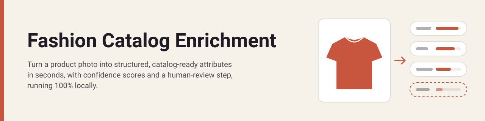
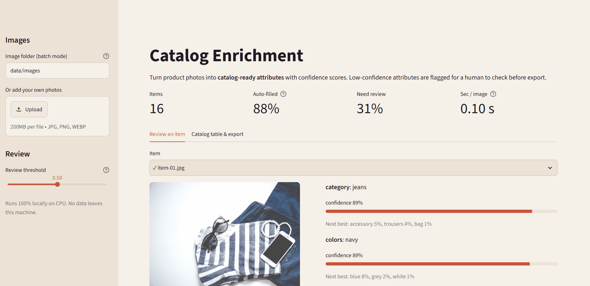
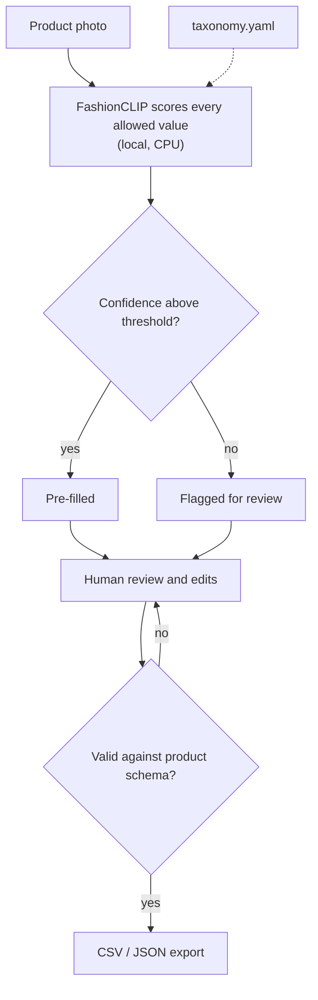
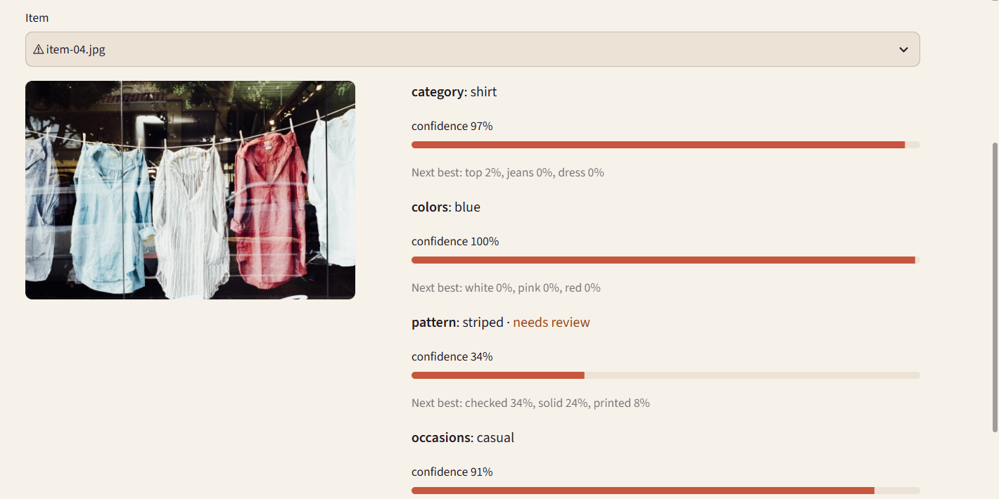
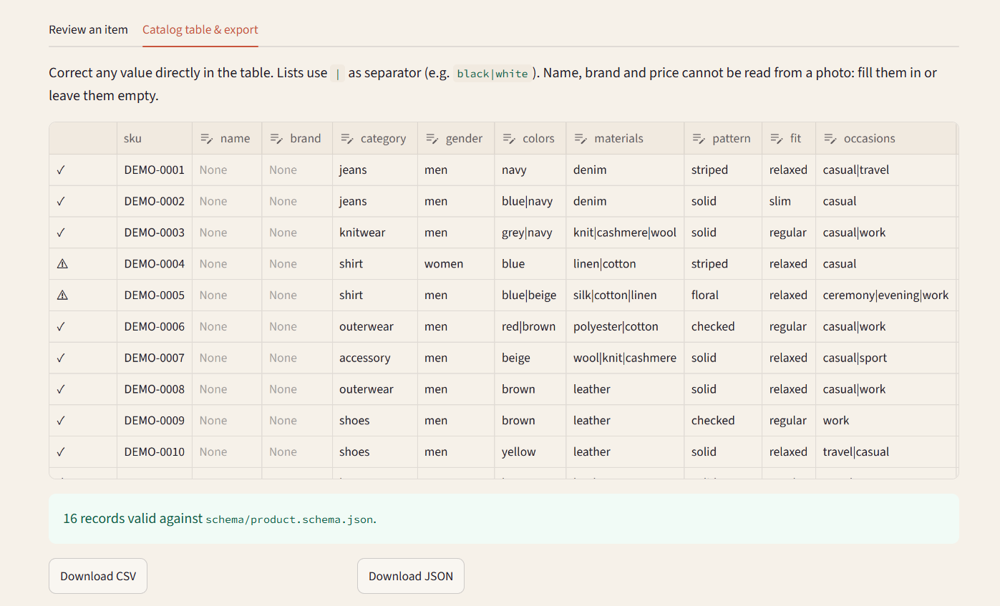

<p align="center">
  
</p>

# Fashion Catalog Enrichment

**Turn a product photo into structured, catalog-ready attributes in seconds, with confidence scores and a human-review step, running 100% locally.**

[](https://github.com/tortonef/fashion-catalog-enrichment/actions/workflows/ci.yml)

[](LICENSE)


## In 30 seconds

Drop in product photos and get category, colors, pattern, occasions and more as structured data that fits the catalog schema.
Every attribute comes with a confidence score; uncertain items are flagged for a person to check before anything is exported.
It runs on an ordinary laptop CPU, with no cloud service and no data leaving the machine.
On the sample set it gets the **category right 81% of the time at about 0.1 seconds per image**, with no training at all.

<p align="center"></p>

## The business problem

Fashion e-commerce catalogs are full of missing or inconsistent attributes. One merchandiser writes "navy", another "dark blue"; a new season arrives and half the products have no occasion or pattern at all.

That hurts the things that sell: **on-site search and filters** miss products, **recommendations** have less to work with, and **merchandisers** cannot build collections by attribute. Fixing it by hand is slow, repetitive work that competes with every other launch task, and the result still varies from person to person.

**Who feels it:** e-commerce catalog teams, merchandisers and content operations, every season.

## Business value

| | Before (manual tagging) | After (AI suggestions + human review) |
|---|---|---|
| Time per new SKU | ~4 min to fill 8 attributes | ~1 min: accept, or fix the flagged attributes |
| Attribute completeness at launch | Depends on who had time | Every attribute pre-filled; gaps are explicit |
| Consistency | Free text varies by person and season | Controlled vocabulary from one taxonomy file |
| Where people spend their time | Typing every value | Checking the ~1 in 3 items the tool flags |

**Example, with illustrative assumptions:** 2,000 new SKUs per season × 3 minutes saved per SKU ≈ **100 hours per season**.

Assumptions behind these figures (replace them with your own data):
- 4 minutes of manual tagging per SKU and 1 minute of review are **estimates, not measurements**.
- "~1 in 3 items flagged" comes from this demo: 5 of the 16 sample images were flagged at the default threshold.
- 2,000 new SKUs per season is an example volume for a mid-sized online fashion retailer.
- Real savings depend on catalog quality, taxonomy size and how much review the business requires.

## How it works



Design choices:
- **Zero-shot, no training.** FashionCLIP compares the photo with a short text description of every allowed value (e.g. "a garment with a striped pattern") and picks the closest. Adding a value means editing [`config/taxonomy.yaml`](config/taxonomy.yaml), not retraining.
- **Local and privacy-first.** The model runs on the CPU from a local cache. The app listens on `localhost` only and works offline after setup.
- **Deterministic checks around the model.** The output can only contain values from the taxonomy, and every export is validated against the shared [product schema](schema/product.schema.json). Invalid edits block the export.
- **Human in the loop.** Each attribute shows its confidence and the next-best options. Items are flagged when a core attribute (category, colors, pattern, occasions) is below the threshold. Fit, season, materials and gender are labelled *experimental*: they are shown but never flag an item, because a single photo rarely tells them reliably.

## Quickstart

**Requirements:** Python 3.12, 8 GB RAM, about 2 GB of free disk. No GPU, no accounts, no API keys.
The first setup downloads about 1 GB (PyTorch CPU and the 580 MB model) and takes 5–10 minutes.

**Windows (PowerShell)**
```powershell
git clone https://github.com/tortonef/fashion-catalog-enrichment.git; cd fashion-catalog-enrichment
powershell -ExecutionPolicy Bypass -File .\setup.ps1
powershell -ExecutionPolicy Bypass -File .\run.ps1
```

**macOS / Linux**
```bash
git clone https://github.com/tortonef/fashion-catalog-enrichment.git && cd fashion-catalog-enrichment
bash setup.sh
bash run.sh
```

The app opens at <http://localhost:8501> on the 16 sample images. The first load of the model takes about 20 seconds.

<details>
<summary>Troubleshooting</summary>

- **"running scripts is disabled on this system"**: use the `powershell -ExecutionPolicy Bypass -File ...` form above; it does not change any system setting.
- **Python 3.12 not found**: install it from [python.org](https://www.python.org/downloads/). On Windows the setup uses the `py -3.12` launcher, which the installer adds by default.
- **"Model not found"** when the app starts: run the setup script again; it resumes the download.
- The setup is safe to run more than once.
</details>

## Using it

<p align="center"></p>

1. **Review an item.** Pick an image: each attribute shows the predicted value, a confidence bar and the next-best options. Here the model is unsure whether the shirts are striped (34%) or checked (34%), so the item is flagged.
2. **Correct and export.** The *Catalog table & export* tab lists every item as a product record. Fix any value in place; the table is checked against the schema live, and CSV/JSON downloads are enabled only when every record is valid.
3. **Batch mode and your own photos.** Point the sidebar's *Image folder* at any folder of JPG/PNG/WEBP files, or upload photos. The review threshold slider changes the review policy without re-running the model.

<p align="center"></p>

Name, brand and price stay empty: they cannot be read from a photo and are left to the people who know them.

## Evaluation

Results from `python -m catalog_enrichment.evaluate` on the 16 sample images, against hand-checked labels in [`data/eval/labels.csv`](data/eval/labels.csv). Full report: [`docs/eval_results.md`](docs/eval_results.md).

| Attribute | Result | Reading |
|---|---|---|
| Category | **81%** accuracy | 13 of 16 right. Errors: a striped top lying on jeans read as "jeans", a plaid shirt as "outerwear", a cream sweater as "accessory". |
| Pattern | **75%** accuracy | Stripes, checks and florals are reliable; plain items are sometimes "seen" as patterned. |
| Colors | 70% precision, 47% recall | Colors it names are usually right, but it finds fewer than half of them, mostly on photos with several garments. |
| Occasions | 55% precision, 84% recall | Finds the right occasion but adds extra ones. |
| Materials *(experimental)* | 62% precision, 89% recall | Good on leather and denim; over-suggests "cashmere". |
| Season *(experimental)* | 69% accuracy | Leans towards spring/summer: 4 of its 5 errors answer "SS", including a cream wool sweater and work boots. |
| Gender *(experimental)* | 29% accuracy (7 images) | Not usable: a garment photo alone does not tell gender. |
| Fit *(experimental)* | not evaluated | Not visible in these photos. |

Speed: about **0.1 s per image** on a laptop CPU.

**Weaknesses to be clear about:** 16 images is a small, indicative sample. Several photos show more than one garment or a close-up of fabric, which is harder than a clean catalog packshot. The sample has no dresses, skirts or trousers. And the review flag catches *uncertain* answers, not *confident mistakes*: the brogues were tagged "checked" with high confidence and were not flagged.

## Responsible AI, limitations and risks

- **Not a replacement for people.** The tool suggests; a person approves. Confident errors exist (see above), so spot-check a sample even of unflagged items.
- **Gender is a stereotype risk.** Inferring gender from a garment repeats patterns in the model's training data. It is labelled experimental, scores poorly, and should not be auto-filled in production.
- **Model scope.** FashionCLIP's own [model card](https://huggingface.co/patrickjohncyh/fashion-clip) says it was not developed for deployment and should be tested in each new context, which is what the evaluation script is for.
- **English-only taxonomy.** Labels and prompts are in English; other languages would need their own testing.
- **Data.** All sample images are CC0, contain no people and no visible brand marks, and had their metadata (including GPS) removed. See [`CREDITS.md`](CREDITS.md).
- **Privacy.** Photos are processed locally and never uploaded; the app is reachable only from the same computer.

## From demo to production

| Area | What a real rollout would need |
|---|---|
| Integration | Read new SKUs and images from the PIM or e-commerce platform; write approved attributes back through its API, with an audit trail. |
| Human-in-the-loop workflow | Review queue in the tools the catalog team already uses; thresholds set per attribute with the business; sampling of unflagged items. |
| Evaluation | A labelled set of a few hundred real SKUs per category and season, re-run before every model or taxonomy change. |
| Accuracy | Fine-tuning or a small classifier on top of the image embeddings, trained on the retailer's own approved attributes. |
| Monitoring | Track the share of flagged items, reviewer correction rate per attribute and confidence drift when a new season arrives. |
| Governance | One owner for the taxonomy; documented rules for which attributes may be auto-approved (and which, like gender, may not). |
| Change management | Pilot with one category, measure time saved against the assumptions above, then expand; train reviewers on what confidence means. |
| Run costs | CPU inference at ~0.1 s per image: 10,000 images take about 17 minutes on one laptop-class machine. No per-call fees. |

**Next steps (not built):** background removal before tagging, products with several images, per-attribute thresholds, a materials model trained on fabric close-ups.

## Models & licenses

| Component | License | Source |
|---|---|---|
| FashionCLIP (`patrickjohncyh/fashion-clip`), pinned revision `7e3ba62` | MIT | [Model card](https://huggingface.co/patrickjohncyh/fashion-clip) |
| Sample images (16) | CC0 1.0 | StockSnap, listed one by one in [`CREDITS.md`](CREDITS.md) |
| This code | MIT | [`LICENSE`](LICENSE) |

<details>
<summary>Project structure</summary>

```
app.py                      Streamlit UI (review, edit, export, ops metrics)
config.yaml                 Model id and revision, paths, thresholds (env vars can override)
config/taxonomy.yaml        Allowed values per attribute and the text shown to the model
schema/product.schema.json  Product record shared by the three repos in this series
src/catalog_enrichment/
  tagger.py                 Zero-shot scoring, confidence and review flags
  model.py                  FashionCLIP loading (offline) and download
  export.py                 Product records, editable table, schema validation, CSV/JSON
  metrics.py                Ops metrics (auto-filled %, flagged %, time per image)
  images.py                 Photo normalization: resize and strip all metadata
  evaluate.py               Accuracy / precision / recall against labels.csv
  smoke.py, download.py     Used by the setup scripts
data/images/                Sample images (CC0)
data/eval/labels.csv        Hand-checked labels for the evaluation
tests/                      Unit tests (model mocked); test_model_slow.py uses the real model
setup.ps1, setup.sh         One-time setup; run.ps1, run.sh start the app
```

Run the tests with `.venv/Scripts/python -m pytest -m "not slow"` (Windows) or `.venv/bin/python -m pytest -m "not slow"` (macOS/Linux).
</details>

## License

MIT, see [`LICENSE`](LICENSE). Sample images are CC0, see [`CREDITS.md`](CREDITS.md).
